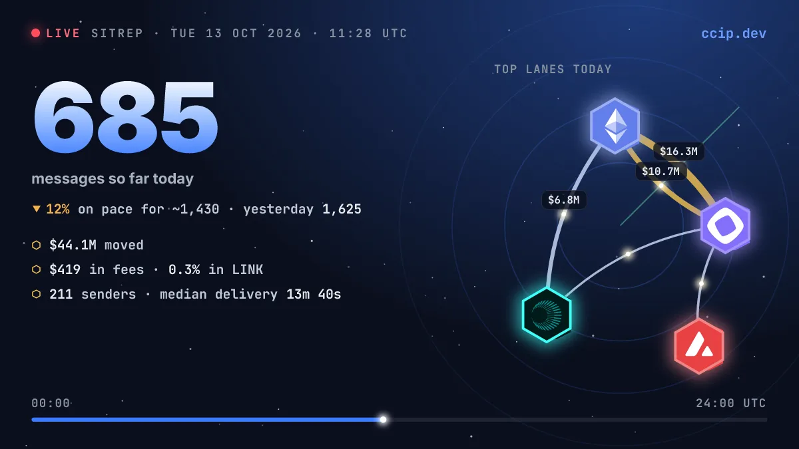
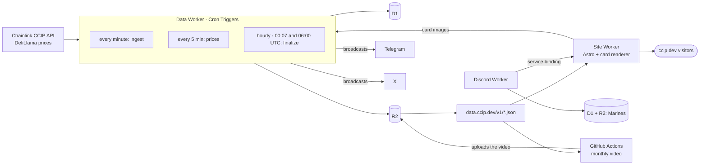

<p align="center">
  
</p>

<p align="center"><b>Every mainnet Chainlink CCIP message since 2023-07-06, live and free to use.</b></p>

<p align="center">
  <a href="https://ccip.dev"><b>ccip.dev</b></a> ·
  <a href="https://x.com/ccipdev">X @ccipdev</a> ·
  <a href="https://t.me/ccipdev">Telegram</a> ·
  <a href="https://discord.com/oauth2/authorize?client_id=1559612174081724456&scope=applications.commands">Add to Discord</a> ·
  <a href="https://data.ccip.dev/v1/status.json">Data API</a>
</p>

<p align="center">
  <a href="https://github.com/momentmaker/ccip-dev/actions/workflows/deploy.yml"></a>
  <a href="LICENSE"></a>
</p>

## What it is

ccip.dev is an unofficial, community-run tracker of every mainnet Chainlink CCIP message since 2023-07-06. Messages come from Chainlink's public CCIP API and token values from DefiLlama prices. Every figure is explained in the [methodology](docs/methodology.md).

## What you get

### The site

A live dashboard, daily history, top lanes, tokens and senders, records, the Chainlink Reserve vault, a cinematic replay of the network and a monthly video.

<table>
  <tr>
    <td width="50%"><a href="https://ccip.dev"></a></td>
    <td width="50%"><a href="https://ccip.dev/records/"></a></td>
  </tr>
  <tr>
    <td width="50%"><a href="https://ccip.dev/reserve/"></a></td>
    <td width="50%"><a href="https://ccip.dev/replay/"></a></td>
  </tr>
</table>

### Broadcasts to X and Telegram

Daily and weekly reports, records, milestones, moments, polls and the monthly video are posted as image cards to [@ccipdev on X](https://x.com/ccipdev) and the [Telegram channel](https://t.me/ccipdev). Designs: [broadcasts](docs/superpowers/specs/2026-10-11-broadcasts-design.md), [moments](docs/superpowers/specs/2026-10-12-moments-design.md), [monthly video](docs/superpowers/specs/2026-10-12-monthly-video-design.md).

### The Discord bot

Enlist for a permanent meme callsign on a pair of dog tags, and pull live CCIP intel as cards. Free, for any server, with no permissions. See [ccip.dev/discord](https://ccip.dev/discord/).

<table>
  <tr>
    <td width="50%"></td>
    <td width="50%"></td>
  </tr>
</table>

Commands: `/enlist`, `/dogtag`, `/cciptoday`, `/ccipchain`, `/linkreserve`, `/cciprecords`.

## The free data API

The JSON behind every page is public at `https://data.ccip.dev/v1/`. Main files:

| File | What it holds |
|---|---|
| `status.json` | freshness and coverage |
| `live.json`, `today.json` | the live feed and today so far |
| `history.json` | daily history |
| `reserve.json` | the Chainlink Reserve |
| `chains.json`, `tokens.json` | the chain and token registries |
| `replay.json` | the data behind the replay |

- Fetch each file **at most once a minute per file**; requests are rate-limited per IP.
- Credit: **Source: ccip.dev**.
- How every number is measured: [docs/methodology.md](docs/methodology.md).

## How it works



- **Data Worker** (`worker/`): Cron Triggers ingest new messages every minute, refresh prices every five minutes, run hourly jobs and finalize each day at 00:07 UTC, with a late re-run at 06:00. It writes D1 and publishes the public JSON to R2.
- **Public JSON** (`data.ccip.dev`): static files served from an R2 bucket, cached and rate-limited at the edge.
- **Site Worker** (`site/`): the Astro site, plus the Worker that draws the share and broadcast cards with Satori and resvg.
- **Broadcasts**: after finalize, the data Worker plans posts, fetches each card from the site's `/og/` route and sends it to Telegram and X.
- **Discord Worker** (`discord/`): answers the bot's slash commands and keeps Marines in its own D1 and R2. It gets its cards from the site through a service binding to the card entrypoint.
- **Monthly video** (GitHub Actions): `monthly-video` records last month's replay headlessly on the 1st of each month and uploads the video to R2; the data Worker posts it.

## The stack

TypeScript in a pnpm workspace. Cloudflare Workers with D1, R2 and Cron Triggers. Astro and React for the site, WebGL for the replay, Satori and resvg for cards. Vitest for tests.

## Develop

```sh
pnpm install
pnpm test
pnpm typecheck
pnpm --filter @ccip-dev/site dev      # the site, locally
pnpm --filter @ccip-dev/site build    # a production build, with its checks
```

| Package | What it is |
|---|---|
| `packages/core` | shared types and logic: metrics, broadcasts, LinkMarine cards |
| `worker` | the data Worker: ingest, prices, finalize, broadcasts |
| `site` | the Astro site and the card-rendering Worker |
| `discord` | the Discord bot Worker |
| `scripts` | maintenance and tooling: labels, backfill, canary, video |

## Docs

- [Runbook](docs/runbook.md): provisioning, deploys and operations
- [Methodology](docs/methodology.md): how every figure is measured
- [Design specs](docs/superpowers/specs/): one per feature

## License

The code is MIT, see [LICENSE](LICENSE). The label data in `labels/` (`labels/projects/*.toml`) is CC BY 4.0, see [labels/LICENSE](labels/LICENSE); attribute it as "ccip.dev" with a link to https://ccip.dev.

## Disclaimer

Unofficial — not affiliated with Chainlink Labs.
