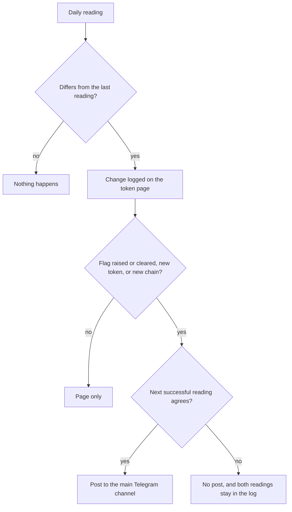
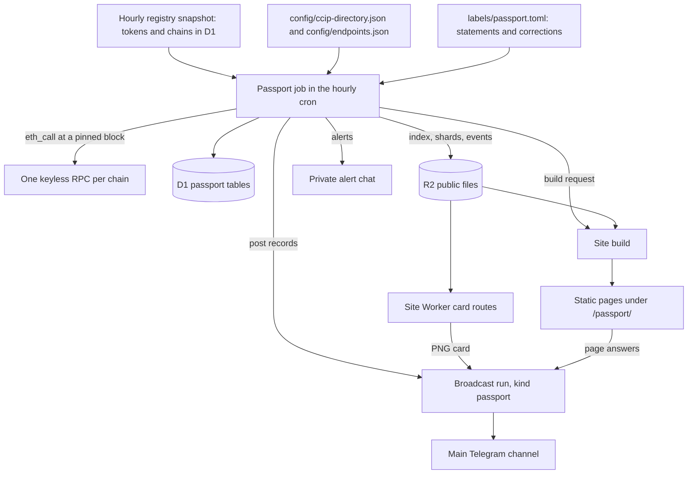
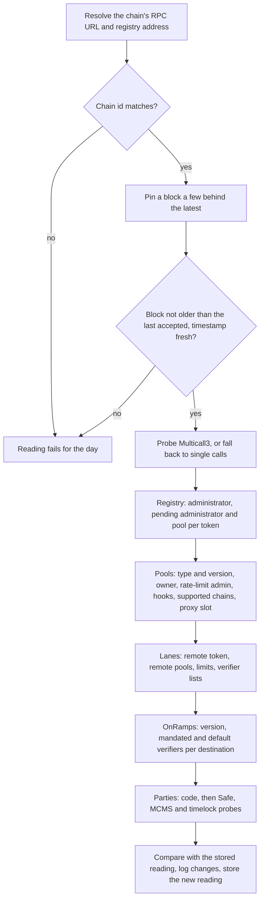
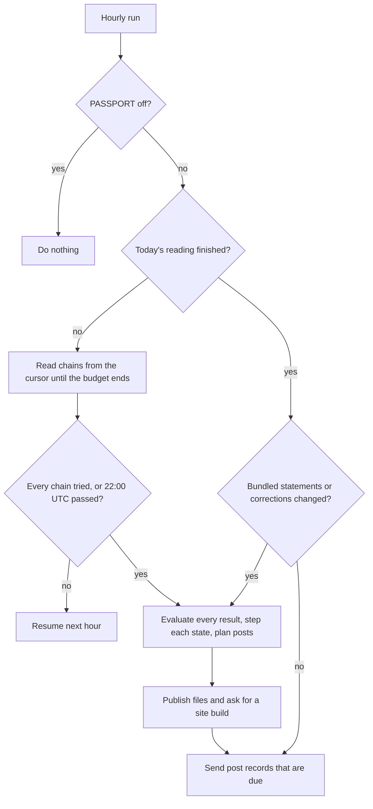
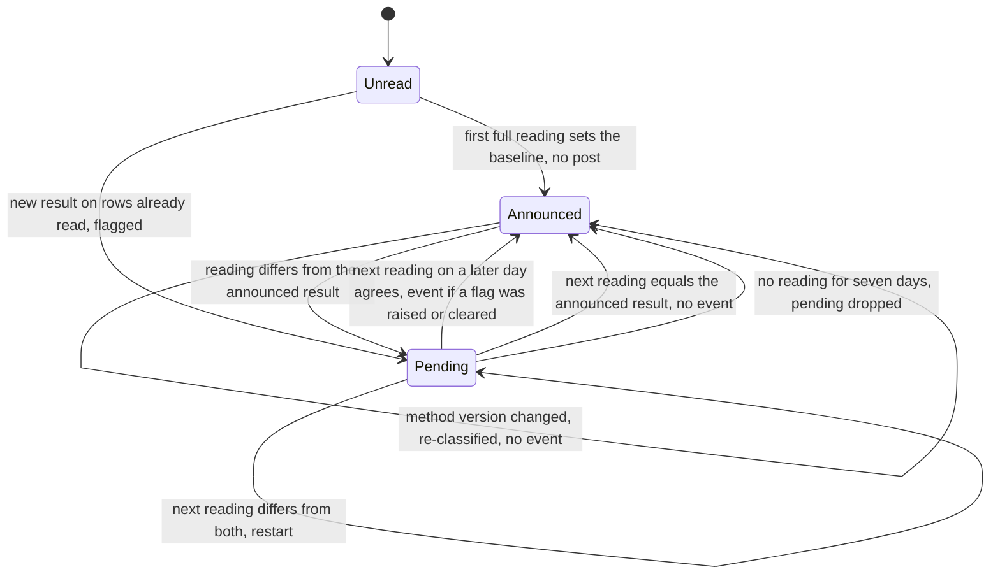
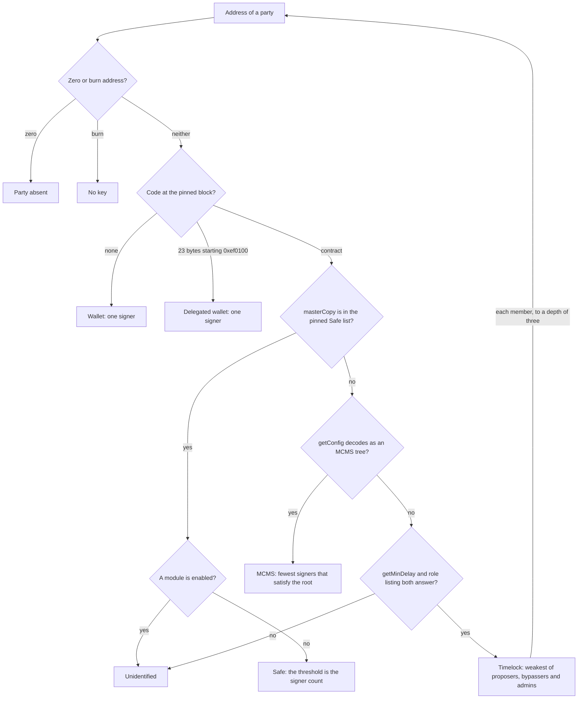
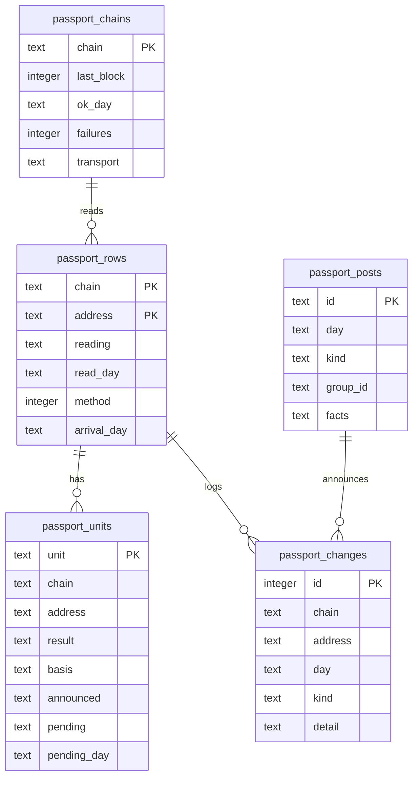

# Token Passport - Plan

## Goal Capsule

- **Objective:** Anyone with a stake in LINK, or in a token that moves over CCIP, can look that token up on ccip.dev, see how its bridge is set up and what has changed, and hear on Telegram when a setting that matters changes.
- **Means:** A Token Passport section on ccip.dev fed by one onchain reading per token and chain each day (KTD3), with posts to the main Telegram channel.
- **Product authority:** momentmaker decides product behavior. This plan covers the record and the Telegram change wire only. The other areas listed under How This Work Fits Together are not active scope.
- **Execution profile:** Code, in five phases. Each unit lands as small commits that pass the Verification Contract. The rules in `packages/core` are written test-first.
- **Stop conditions:** Stop and ask momentmaker when evidence contradicts a session-settled decision, when the Cloudflare account turns out to be on the Workers Free plan, when a step would publish the section or post to Telegram, or after three failed attempts at one problem.
- **Who finishes and ships:** The implementer lands the code with both switches off (KTD20). momentmaker runs the dry run and the hand check, then turns on `PASSPORT` and later `PASSPORT_PUBLIC`.
- **Open blockers:** None.

---

## Product Contract

**Product Contract preservation:** changed: R5 and R20 reworded, R31 to R39 and AE10 to AE15 added, one Key Decision added from a new user choice and six from confirmed clarifications. momentmaker confirmed each on 2026-11-23, and no requirement was dropped or weakened.

### Summary

A Token Passport section on ccip.dev gives every cross-chain token a page that runs one fixed checklist against daily readings from chain.
Each check shows its result with the date of the reading, and the page keeps a dated log of changes.
A change that raises or clears a flag, a new token, or a token's arrival on a new chain posts to the main Telegram channel.
This plan builds the whole record and wire and refactors no existing code.
Telegram carries at most ten token posts a day plus one summary post.

### Problem Frame

Since CCIP 2.0 launched on 2026-09-28, each token issuer chooses its token's cross-chain settings: which verifiers the token requires, its rate limits, and who may change them.
An issuer can change those settings on any day.

The official CCIP Directory lists supported tokens and their current rate limits.
It shows no history, no verifier set, and nothing about who holds the admin keys.
A search on 2026-11-19 found no public per-token record of these settings for CCIP.

A person who holds LINK or a token that moves over CCIP cannot see these settings without reading pool contracts.
Nobody has asked ccip.dev for this yet.
The need is inferred from the CCIP 2.0 change and from the per-application config analyses that appeared for LayerZero after the Kelp DAO exploit.

### Key Decisions

- **The first piece is the record plus a Telegram change wire.** (session-settled: user-directed — chosen over the record alone and over posting to X as well: the wire gives the record its own distribution, and X is left out.) Governs R18, R19, R24.
- **The whole record and wire ship together for every token.** (session-settled: user-directed — chosen over a narrow first slice: there is no time pressure.) Governs R1.
- **Every page shows the same checklist with every result.** (session-settled: user-directed — chosen over pages that mark only warnings: a clean page and an unreadable page must not look alike.) Governs R5, R7, R10.
- **Results that stand out carry a warning flag, and no page has an overall score.** (session-settled: user-directed — chosen over plain notes without flags, facts only, and an overall grade: flags are more shareable, at the cost of sitting closer to judgment.) Governs R9, R14.
- **It goes public as soon as readings can be trusted.** (session-settled: user-directed — chosen over a few unpublished weeks with advance notice to flagged projects: faster, with no notice and no history at launch.) Governs R25, R30.
- **On a busy day, ten tokens get their own post and one summary covers the rest.** (session-settled: user-directed — chosen over holding the day's posts for the operator above a threshold, one post per token with no cap, and posting everything: the channel stays readable and nothing waits on the operator.) Governs R34, R35.
- **Only flag changes, new tokens and new chains post to the main Telegram channel.** (session-settled: user-approved — chosen over a separate channel carrying every change and over one daily digest: the main channel stays readable.) Governs R18, R19, R23.
- **A Telegram post waits for two daily readings that agree.** (session-settled: user-approved — chosen over posting on the first reading: one bad RPC answer cannot post a false warning, at the cost of a day's delay.) Governs R20.
- **The two readings are two successful readings, up to seven days apart.** (session-settled: user-approved — chosen over two calendar days in a row: a chain with a flaky endpoint might never get a real flag posted.) Governs R20.
- **A failed read keeps the last result on the page for up to seven days.** (session-settled: user-approved — chosen over showing "not readable" on the first failed day: an RPC outage would hide a real flag.) Governs R5, R31.
- **The sending chain's outbound limit decides the rate-limit flag and the per-hour figure.** (session-settled: user-approved — chosen over the lower of both sides and over flagging when either side is off: those rules break when one side cannot be read, or flag a lane whose figure is finite.) Governs R36.
- **A single key is any party who can act alone.** (session-settled: user-approved — chosen over flagging plain wallets only: a multisig that needs one signature, or a timelock one key can bypass, gives one key the same power.) Governs R37, R39.
- **A first reading and a change in method never post.** (session-settled: user-approved — chosen over posting them as changes: neither is a change in the token's settings.) Governs R32, R33.
- **A statement is accepted only from a channel tied to the project or with a signature.** (session-settled: user-approved — chosen over taking any contact's word: anyone can claim to be the team.) Governs R38.
- **A team's statement is shown beside the result, and the reading stays the authority.** (session-settled: user-approved — chosen over clearing a flag on a team's word alone: an adjustment is labeled as what the team said.) Governs R27, R28.
- **Required verifiers are shown and never flagged.** (session-settled: user-approved — chosen over flagging single-verifier setups: every token uses the default verifier today, so the flag would land on all of them.) Governs R11.
- **The verifier record is a line on each token's page.** (session-settled: user-approved — chosen over a separate verifier league table: there is one verifier to list today.) Governs R8, R11.
- **It ships on ccip.dev.** (session-settled: user-approved — chosen over onchainlink.com and offchainlink.com: branding on those needs Chainlink's written permission.) Governs R29.
- **The checklist starts with five checks.** They are the settings an issuer chooses that a reader can act on. Governs R8.
- **The page shows each reading the day it is taken; only Telegram waits for confirmation.** The page is a dated record, and a broadcast is harder to take back. Governs R4, R20.
- **A new-token or new-chain post waits for the same confirmation and names the token's flags.** One confirmed post says more than an early post followed by a flag post. Governs R20, R21.

### Actors

- A1. Reader: someone with a stake in LINK or in a token that uses CCIP. Not a contract expert.
- A2. Project team: the issuer or team behind a token. May dispute a result or send a statement.
- A3. Operator: the ccip.dev maintainer. Corrects wrong readings and attaches team statements.
- A4. Telegram subscriber: follows the main ccip.dev channel.

### Requirements

**Coverage and readings**

- R1. Every token in ccip.dev's token registry has a Token Passport page, and one token on several chains is one page.
- R2. A page names its token by symbol and name, lists its chains, and names the project where ccip.dev's labels tie the token to one.
- R3. Each page's settings come from readings taken from chain once a day, over free data sources only.
- R4. Every reading shown carries the date it was taken.
- R5. A check whose setting cannot be read or classified shows "not readable" and never "clear". R31 covers a failed daily read.
- R31. After a failed daily read, a check keeps its last result with that result's date for up to seven days, then shows "not readable".
- R6. An index lists every token with its check results, so a reader can find a token and see which tokens carry flags.

**The checklist**

- R7. Every page runs the same fixed checklist and shows a result for every check.
- R8. The checklist covers five settings: who can change the token's bridge settings, whether each lane's rate limit is on, how much can leave per hour on each lane, whether the token's pools on each chain point at each other, and which verifiers each lane requires.
- R9. Three checks can raise a flag: a single key can change the bridge settings, a lane's rate limit is switched off, or the token's pools on different chains do not point at each other.
- R10. A check that can raise a flag shows one of three results: flagged, clear or not readable.
- R11. The required verifiers are shown as a fact and never raise a flag.
- R12. "How much can leave per hour" shows in token units and, where ccip.dev has a price for the token, in dollars.
- R13. Each result carries a one-line note that a reader without contract knowledge can follow.
- R14. A page carries no overall score, grade or rank.
- R15. The rule behind each check and each flag is published in ccip.dev's methodology.
- R36. The rate-limit check and the per-hour figure read the sending chain's outbound limit; the receiving chain's inbound limit is shown as a note and raises no flag.
- R37. A single key means one party who can change the settings alone: a plain wallet, a multisig that needs one signature, or a timelock that one key can propose through or bypass.
- R39. The single-key check shows "clear" only when every party who can change the settings is identified as needing two or more signers.

**Change log**

- R16. Each page shows a dated log of every change in a checked setting since recording began.
- R17. A correction of a wrong reading is logged as a correction, distinct from a change in the token's settings.
- R32. A result that changes only because ccip.dev changed how it reads or classifies a setting is logged as "re-classified" and does not post.

**Telegram change wire**

- R18. A change that raises or clears a flag posts to the main ccip.dev Telegram channel.
- R19. A token's first appearance in the registry after launch, and a token's arrival on a new chain, post to the same channel.
- R20. A post goes out only after two consecutive successful readings agree, taken on different days no more than seven days apart.
- R21. A new-token or new-chain post names any flags the token carries.
- R22. Each post names the token, states the change in plain language and links to the token's page.
- R23. No other change posts to Telegram.
- R24. Nothing from Token Passport posts to X.
- R25. At launch, the first reading of each existing token sets its baseline and posts nothing.
- R33. The first successful reading of a token on a chain sets the baseline for that chain's checks and posts no flag change.
- R34. A token gets at most one post a day, and that post carries all of the token's confirmed changes.
- R35. On a day when more than ten tokens have something to post, ten get their own post, flag changes first, and one summary post covers the rest.

**Disputes and team statements**

- R26. Each page tells a project team how to reach the operator about a result.
- R27. The operator can attach a team's statement to a result, shown as the team's own words with its date.
- R28. A result changes only when the reading changes or the reading was wrong; a team's statement alone does not clear a flag.
- R38. The operator attaches a statement only when it comes from a channel tied to the project or is signed by an address that controls the token's pool.

**Publication**

- R29. Token Passport is a section of the existing ccip.dev site.
- R30. It goes public without an unpublished recording period and without advance notice to projects.

### Key Flows

- F1. A reader looks up a token
  - **Trigger:** A reader wants to know how a token's bridge is set up.
  - **Actors:** A1
  - **Steps:** The reader finds the token in the index, opens its page, reads each check's result with its note and date, then reads the change log.
  - **Outcome:** The reader knows who can change the settings, how much can leave per hour, which verifiers are required, and what has changed.
  - **Covered by:** R1, R2, R4, R6, R7, R13, R16
- F2. A setting changes
  - **Trigger:** A daily reading differs from the one before it.
  - **Actors:** A1, A4
  - **Steps:** The page logs the change the same day. If the change raises or clears a flag, the post waits for the next successful reading. When that reading agrees, the post goes out.
  - **Outcome:** The page is current the day of the reading. Telegram carries a flag change one day later.
  - **Covered by:** R16, R18, R20, R22, R23
- F3. A team disputes a result
  - **Trigger:** A project team contacts the operator about a result on its token's page.
  - **Actors:** A2, A3
  - **Steps:** The operator checks the reading against the chain. If the reading was wrong, the operator corrects it and the log records a correction. If the reading was right, the operator attaches the team's statement beside the result.
  - **Outcome:** The page shows the reading and, where given, the team's own words.
  - **Covered by:** R17, R26, R27, R28, R38
- F4. A token appears or reaches a new chain after launch
  - **Trigger:** The registry gains a token, or a token gains a chain.
  - **Actors:** A1, A4
  - **Steps:** The token's page is created or extended and its first reading is taken. When the second successful reading agrees, one post announces it and names any flags.
  - **Outcome:** The token has a page from its first reading and one confirmed Telegram post.
  - **Covered by:** R1, R19, R20, R21, R22

The posting rule in F2 and F4, as a diagram:

### Acceptance Examples

- AE1. **Covers R5, R7.** Given a token on Ethereum and Solana whose Solana pool cannot be read, when a reader opens its page, the Ethereum checks show their results and the Solana checks show "not readable". Nothing for Solana shows "clear".
- AE2. **Covers R9, R16, R18, R20.** Given a token whose admin was a multisig yesterday, when today's reading shows a single key, the page logs the change and shows the flag today. The Telegram post goes out after tomorrow's reading also shows a single key.
- AE3. **Covers R16, R20.** Given the same token, when tomorrow's reading shows the multisig again, no Telegram post goes out. The log keeps both readings with their dates.
- AE4. **Covers R11.** Given every lane of a token requires only the default verifier, the verifier check lists that verifier and shows no flag.
- AE5. **Covers R9, R12.** Given a lane whose rate limit is switched off, the rate-limit check is flagged and the per-hour figure reads "no limit". Given a token with no price on ccip.dev, the per-hour figure shows token units only.
- AE6. **Covers R25.** Given launch day, when the first readings find tokens with a single-key admin, their pages show the flag and no Telegram post goes out.
- AE7. **Covers R27, R28, R18.** Given a team says its single key is a deployer key about to move to a multisig, the page keeps the flag and shows the team's statement beside it with its date. When later readings show the multisig, the flag clears and the clearing posts to Telegram.
- AE8. **Covers R19, R20, R21.** Given a token is added to the registry after launch with one lane's rate limit switched off, when its second daily reading agrees with the first, one Telegram post announces the token and names that flag.
- AE9. **Covers R17, R18.** Given a flag was posted and the operator later finds the reading was wrong, the correction clears the flag, the log marks it as a correction, and the clearing posts to Telegram.
- AE10. **Covers R20, R31.** Given a token flagged for a single key on Monday, when Tuesday's read of that chain fails and Wednesday's read shows the single key again, the page shows the flag on all three days, with Monday's date on Tuesday. The post goes out on Wednesday.
- AE11. **Covers R32.** Given ccip.dev starts recognising a multisig type it could not classify before, when 40 tokens move from "not readable" to "clear" that day, each log shows "re-classified" and no post goes out.
- AE12. **Covers R34, R35.** Given a day when 25 tokens have something to post and 3 of them are flag changes, the 3 flag changes and 7 other tokens each get one post, and one summary post covers the other 15.
- AE13. **Covers R18, R33.** Given a token already being read on Ethereum opens a new lane with its rate limit off, the flag posts after the next successful reading agrees. Given a chain is read for the first time after launch, its tokens' flags show on their pages and nothing posts.
- AE14. **Covers R36.** Given a lane whose outbound limit on the sending chain is on and whose inbound limit on the receiving chain is off, the rate-limit check is clear, the per-hour figure comes from the outbound limit, and a note says the receiving side sets no limit.
- AE15. **Covers R37, R39.** Given a pool owned by a multisig where any one of three keys can sign, the single-key check is flagged. Given a multisig that needs two of three keys owns the pool and every other party is identified the same way, the check is clear. Given the owner is a contract ccip.dev cannot identify and no other party is a single key, the check shows "not readable".

### Success Criteria

- Before launch, a hand check of a sample of tokens against the chain finds no wrong reading on their pages.
- Within two months of launch, someone outside X links to a token page.
- Within two months of launch, a project team sends a statement or a correction.
- Within two months of launch, no flag has been retracted because of a wrong reading.

### Scope Boundaries

**Deferred for later**

- Posting to X.
- An embeddable badge and a supported machine-readable feed for issuers, wallets and agents.
- A time machine that shows a token's settings on any past date, and any history from before launch.
- A launch self-check where an issuer pastes its pool addresses.
- A cross-rail view with the same token's LayerZero settings.
- A compliance line showing who can freeze or block transfers.
- A verifier comparison table, verifier timing and fees, and verifier operator profiles.
- Project teams claiming their own page, and any paid alerts, webhooks or API.
- A separate Telegram channel carrying every change.
- Marking a freshly changed result as unconfirmed on the page.
- Links from existing project pages back to token pages.

**Outside this product's identity**

- An overall score, grade or ranking of tokens.
- Advice on whether a token is safe to hold or bridge.
- Any use of onchainlink.com or offchainlink.com.

**Deferred to Follow-Up Work**

- Readers for Solana, Aptos and Canton tokens. They show "not readable" until then (KTD8).
- Following a USDC-style proxy pool to its underlying pools, so its lane checks can be read.
- Identifying Compound-style timelocks, governors and stock OpenZeppelin timelocks. They show "not readable" until then.
- The receiving chain's lane-level verifier lists from the OffRamp.
- A pool's pending owner, which has no view function.
- Detecting upgradeable pools that keep their upgrade party outside the EIP-1967 admin slot, such as UUPS and beacon proxies.

**Considered and not built**

- A per-result hold that stops one post. A correction entry or the `PASSPORT_PUBLIC` switch already stops it; build it if the operator ever needs to stop a post without stating a corrected result.
- Treating a large registry addition as a baseline. The cap in R35 already bounds it; revisit if summary posts turn out to announce old tokens the registry only now lists.
- JSON-RPC batching and a deployless multicall. Multicall3 plus single calls covers the same chains with one fallback; revisit if the dry run shows chains too slow to read call by call.
- Code that verifies a statement's signature. The operator checks it by hand and records how; build it if statements become frequent.
- A tombstone page for a token whose registry group disappears. No group has disappeared yet; build it when one does.
- An alert for a flag that flips every day. The two-reading rule already keeps it off Telegram; build it if the pending alert shows the same token repeatedly.

<!-- ce-section: work-relationships -->
### How This Work Fits Together

This plan covers the record and the Telegram change wire.
The breakdown below is the current understanding, not a committed roadmap.

- Embeddable badge and feed. Depends on the record.
- Time machine. Depends on the record's history building up after launch.
- Issuer launch self-check. Shares the record's chain readers. Can proceed independently of the pages.
- Verifier comparison table. Depends on the record's verifier readings. Still to decide whether it is worth building before a second verifier carries production traffic.
- Cross-rail view with LayerZero settings. Shares the token pages. Can proceed independently of this plan's requirements.
- Compliance line. Still to decide, and depends on whether the setting can be read from chain.
- Paid layer: claimed pages, alerts and API. Depends on the record and on evidence that someone wants it.
- X posting. Can proceed independently of everything above.
- The other ideas from the 2026-11-19 ideation (CRE Watch, First Sighting, Ask the owners, Reward statement) are separate work. Ask the owners could supply the demand evidence this plan lacks.

### Dependencies / Assumptions

- Demand is unobserved. On 2026-11-22 the maintainer confirmed nobody has asked ccip.dev for this. The Success Criteria are the first test.
- The five settings in R8 are free to read on EVM chains. The read layouts for pool versions 1.5.0, 1.5.1, 1.6.x and 2.0.0 were checked against live pools on 2026-11-22 (`docs/research/2026-11-22-ccip-pool-read-surface.md`).
- The verifiers a lane requires can depend on amount, so a lane may have more than one answer.
- ccip.dev's token registry, per-chain keyless RPC list, Telegram posting and project labels exist and can be extended. No code reads token pools, rate limits or verifiers today.
- The registry held 1,248 rows in 301 groups on 2026-11-23, so there are about 301 pages. About 1,184 rows are on EVM chains; 57 are on Solana, 6 on Aptos and 1 on Canton.
- Six EVM chains that hold tokens have no entry in `config/endpoints.json`, and the file holds one URL per chain with no fallback.
- A broadcast kind left out of the X list posts to Telegram only. The stLINK peg posts already work this way.
- The static site rebuilds only on a trigger or on schedule, so a page is current the same day only if the daily job asks for a build.
- Readings must fit within free RPC limits and D1's read budget. History publishes overloaded D1 on 2026-11-04.
- The claim that admin keys and rate limits are where most per-token risk sits today is reasoning and was not checked.
- Chainlink could add verifier or admin columns to its Directory. The record's history and flags would remain the difference.
- Flagging named projects in public, some of them Chainlink's customers, may draw objections. R26 to R28 and R38 are the agreed response.

### Outstanding Questions

**Deferred to Implementation**

- The value of `FinalityCodec.WAIT_FOR_FINALITY_FLAG`, which KTD24 compares `getAllowedFinalityConfig()` against. The pool source suggests zero; confirm it in the library.
- Which chains lack Multicall3 at its usual address, refuse `eth_getStorageAt`, or cannot answer at a block a few behind the latest. The dry run measures this; zkSync Era and other ZK Stack chains are expected to take the single-call path.
- How the CCIP API assigns a row's `groupId`, and whether a row can join another project's group on a one-way pointer. The dry run lists every pair flagged from one side only; a row found on a page it does not belong to stops the launch until arrivals and pair flags are guarded against it.
- How far behind the latest block each chain's pinned block sits, and how old a block's timestamp may be. Start at 12 blocks and 3 hours and adjust per chain from the dry run.
- The pinned Safe singleton addresses for versions 1.4.1 on L2 and 1.5.0, taken from the safe-deployments repository.
- Whether the `tron-mainnet-evm` endpoint speaks Ethereum JSON-RPC.
- The field names inside the three public files, and whether 16 shards keep each file comfortably small.
- How the dry run's files are served to a local site build for the visual check.

### Sources / Research

- `docs/research/2026-11-22-ccip-pool-read-surface.md`: registry, pool, hooks and OnRamp getters by version, return layouts, rate-limit meaning, and non-EVM readability.
- `docs/research/2026-11-22-admin-classification-and-limits.md`: recognising wallets, Safes, MCMS and timelocks, Multicall3, block pinning, and Cloudflare and Telegram limits.
- `reports/Chainlink CRE product opportunities.md`: the 2026-11-05 research that led to the ideation behind this plan.
- `docs/methodology.md`: where each published figure's rule is documented, and the statement that all data sources are free.
- `worker/migrations/0001_init.sql`: the `tokens` and `chains` tables that R1 builds on.
- `worker/src/index.ts`: the `JOBS` map a new job joins.
- `worker/src/jobs/hourly.ts`: `refreshCoingeckoIds`, the pattern for a daily step inside the hourly cron, and `snapshotRegistry`.
- `worker/src/jobs/staking.ts`: a resumable scan with a cursor in `meta` and a wall-clock budget.
- `packages/core/src/eth-rpc.ts`, `packages/core/src/peg-live.ts`, `packages/core/src/staking.ts`: hand-encoded `eth_call`s, `resultWords`, and `classifyStakers`.
- `packages/core/src/peg-episodes.ts`: `stepPeg`, the existing confirm-twice state machine.
- `worker/src/publish.ts`, `packages/core/src/public.ts`: `putJson`, the TTL map, `PUBLIC_SCHEMAS`, and the `stakers/<0-f>.json` shards.
- `worker/src/site-build.ts`: `triggerSiteBuild`.
- `worker/src/broadcasts/run.ts`, `worker/src/broadcasts/outputs.ts`, `packages/core/src/broadcasts.ts`: the broadcast pipeline and `X_KINDS`.
- `site/src/pages/projects/[slug].astro`, `site/src/lib/projects.ts`, `site/src/lib/card-paths.ts`, `site/worker/og.ts`: the per-entity page and share-card pattern.
- `site/scripts/check-build.ts`: fails the build on a repeated `<title>` or a missing methodology anchor.
- `scripts/build-labels.ts`, `labels/projects/`, `.github/ISSUE_TEMPLATE/label.yml`: the operator file pipeline.
- `IMPLEMENTATION_PLAN.md`: the D1 read-load findings from 2026-11-04.
- [Introducing CCIP 2.0](https://chain.link/blog/introducing-ccip-2-0): issuer-chosen verifiers and the Open CCV Marketplace.
- [CCIP v2.0.0 advanced pool hooks](https://docs.chain.link/ccip/evm/api-reference/v2.0.0/advanced-pool-hooks): verifier config views and events.
- [TokenPool.sol at contracts-ccip-v2.0.0](https://github.com/smartcontractkit/chainlink-ccip/blob/contracts-ccip-v2.0.0/chains/evm/contracts/pools/TokenPool.sol): `_consumeFastFinalityOutboundRateLimit` falls back to the standard limit when the fast-finality limit is off, read on 2026-11-23.
- [CCIP Directory](https://docs.chain.link/ccip/directory): what the official surface already shows.
- [ETHBEAT on CCIP](https://ethbeat.org/interop/protocols/ccip) and [L2BEAT Interop](https://l2beat.com/interop/summary): the nearest existing records, both at protocol level.
- [Chainlink terms](https://chain.link/terms): the Trademark Guidelines that rule out the two Chainlink-named domains without permission.

---

## Planning Contract

### Key Technical Decisions

**Identity**

- KTD1. **A result belongs to a registry row, and a page is a view over a group's rows.** The single-key result keys on `(chain, token address)`, the rate-limit result on that row plus the remote chain, and the pool-pointer result on the unordered pair of rows. Nothing keys on the group, the chain alone, or the pool address. `upsertTokens` overwrites `group_id` every hour and keeps no history, and three groups hold two rows on one chain, so state keyed any other way would post a false clear and a false raise when a row moves.
- KTD2. **A page's address is its registry `group_id`, at `/passport/<group_id>/`.** A row with no group is its own page. The page's name is the most common non-blank symbol and name among its rows; a tie goes to the Ethereum row, then to the lowest chain selector; a group with no name shows "Unnamed token" and a short address. The `<title>` adds a short id when two groups share a symbol and name, because `site/scripts/check-build.ts` fails the whole site build on a repeated title and EARNM, SDM and TAO each belong to two groups. A new token is a group whose every row was first seen after the launch watermark `passport:since`; a new chain is a later row joining a group that has an older row. A row the registry has not listed for more than seven days is marked "no longer listed", is no longer read, and posts nothing.

**Reading**

- KTD3. **The job takes one full reading per chain per day with `eth_call` and compares it with the stored one; it scans no events.** Free endpoints refuse wide or historic `eth_getLogs`, and `eth_call` works on all of them. A change made and undone within one day is missed, and the methodology says so.
- KTD4. **Registry and router addresses and verifier names come from a checked-in file, and pool addresses come from each chain's TokenAdminRegistry.** `config/ccip-directory.json` is rebuilt by the daily `endpoints` workflow from Chainlink's keyless directory and verifier endpoints, and reaches `main` through the same hand-reviewed pull request as `config/endpoints.json`. The reader confirms a registry's `typeAndVersion()` names a TokenAdminRegistry before trusting it. A wrong registry address would publish wrong results about a named project, so it gets the review the RPC URLs already get.
- KTD5. **Every read for a chain uses one pinned block, behind three guards, through Multicall3 with a single-call fallback.** The guards reject the chain's reading for the day when `eth_chainId` differs from the `chains` row, when the block is lower than the last one accepted for that chain, or when the block's timestamp is too old. Multicall3 is used with `allowFailure` only after its code is present and its `getChainId()` matches; otherwise the same calls go out one by one. A revert is an answer. A request that meets a rate limit, a server error, a timeout or a missing block is retried up to three times with a short backoff at the same pinned block. A Multicall3 batch that still fails is split and retried down to single calls, and a call that fails alone fails only the rows that depend on it: they keep their stored reading under R31 and are named in an alert. A chain's reading fails for the day only when a guard fails or its endpoint stops answering, and the chain is tried once more in a later run before the failure counts.
- KTD6. **The pool reader asks for every version's getters in one pass and treats a revert as "this pool does not have it".** The version comes from `typeAndVersion()` split at its last space, and `1.6.x-dev` reads as 1.6. Selectors and return layouts are those in `docs/research/2026-11-22-ccip-pool-read-surface.md` sections 3, 4, 5 and 11; tests recompute each selector from its signature. A custom pool that lacks a getter is read as far as it answers, and each missing piece carries a reason. A party is absent only when its getter answers the zero address; on a pool type the reader knows, a getter that should answer and does not leaves that party unidentified. Text and byte values read from chain are capped in length, and text is sanitised like registry names before it is stored or published.
- KTD7. **The parties behind the single-key check are the pool owner, the token's registry administrator, the rate-limit admin, the owner of a 2.0 pool's hooks contract, and the proxy admin when the pool is an EIP-1967 proxy.** Each address resolves to a signer count by the rules in `docs/research/2026-11-22-admin-classification-and-limits.md` section 1, with these choices for this work. A wallet, and a wallet with EIP-7702 delegated code, is one signer, because its key can still act alone. A Safe is recognised only when `masterCopy()` is in a pinned singleton list, and counts its threshold; a Safe with a module enabled is unidentified. An MCMS counts the fewest signers that satisfy its root group. An RBACTimelock takes the weakest of its proposers, bypassers and admins, each resolved the same way to a depth of three. The zero address means the party is absent, and a burn address means no key. Anything else is unidentified. The check's result follows R37 and R39: flagged when any party is one signer, "not readable" when none is and any party is unidentified or the proxy status is unknown, clear otherwise. A pool whose type name is not one of the standard names in section 4.3 of the pool research may have roles behind other functions, so its check is flagged when a known party is one signer and otherwise "not readable"; it is never clear. An upgradeable pool that keeps its upgrade party outside the EIP-1967 admin slot is not detected, and the methodology says so. The registry's own owner is left out because the issuer does not choose it.
- KTD8. **At launch these show "not readable": every check on Solana, Aptos and Canton rows and on chains with no endpoint or directory entry, and the lane checks of USDC-style proxy pools.** (session-settled: user-approved — chosen over holding the launch until readers exist for them: about 70 of 1,248 rows are affected and each says why.) The single-key check on a proxy pool still reads, because `owner()` answers.

**Rules**

- KTD9. **Only configuration is compared between readings.** That is the pool address, type and version, the parties in KTD7 and their signer facts, each lane's remote token, remote pools, limit switch, capacity and rate, and its verifier lists. A bucket's fill level and `lastUpdated` move on every read and are never stored. The dollar figure moves with price and is never logged. A pool replaced by one with the same settings logs "pool replaced" and changes no result.
- KTD10. **The pool-pointer check is flagged when one side of a pair fails to point at the other.** That means A's remote token for B's chain is not B's row, A's remote pools for B's chain do not contain B's registry pool, or the same fails from B, including B not listing A's chain at all. Several remote pools on one lane are normal after an upgrade, so the test is "contains". A pair where neither side lists the other is not a lane and has no result. A pair is evaluated only on a day both rows were read; on other days it keeps its last result and date under R31, so readings from different days are never mixed. A row that cannot be read by design, or a remote chain where the group has no registry row, gives "not readable". The result belongs to the pair, so one broken pointer is one flag and not one per direction.
- KTD24. **On a 2.0 pool the rate-limit flag reads the standard limit only, and a fast-finality limit that is on adds a second per-hour figure.** A fast-finality limit that is switched off falls back to the standard limit in the 2.0 pool source, so it is never "no limit". A fast transfer draws only from the fast-finality limit when that limit is on, so when the pool allows fast finality, meaning its `getAllowedFinalityConfig()` is not the wait-for-finality value, the page shows that limit's per-hour figure beside the standard one. The standard figure alone would understate how much can leave (R12).
- KTD11. **The verifier line shows what the sending side requires.** The sending side is the side R36 reads. It lists the lane's mandated verifiers and the pool's outbound list, or the lane's default verifiers when the pool sets none, and adds "and these at or above this amount" when the pool has a threshold list. The pool's inbound list for the same remote chain is a second line. A lane on a 1.x OnRamp reads "CCIP 1.x lane (no verifier set)". Names come from the directory file, and an address not in it shows as a custom verifier.
- KTD12. **Each flag-capable result carries an announced state, and a reading is compared with what subscribers were last told.** (session-settled: user-approved — chosen over comparing with the day before only: one rule then covers a flag that flips back, a read that fails on the confirming day, and a correction.) A flagged or clear result that differs from the announced state becomes pending. The next reading that agrees with the pending result, on a later day and within the window R20 sets, becomes the announced state. A reading equal to the announced state drops the pending result. A result counts as read on a day only when every row it depends on was read that day. A second evaluation on the same day replaces that day's outcome and never confirms. An event is a flag raised or a flag cleared: a confirmed flagged result when the announced state was not flagged, or a confirmed clear result when it was flagged. Any other confirmed difference updates the announced state without an event. A "not readable" result is logged on the page, never changes the announced state and never creates an event, because R18 and R23 allow posts only for a flag raised or cleared. R33 sets the baseline; a result that first appears on rows already read on an earlier day is a change, so a new lane's flag goes through confirmation.
- KTD13. **A method version stamps every stored reading and result.** When a result differs from the stored one, the stored one carries another version, and the values read directly from chain that the result rests on are unchanged, the log entry is "re-classified" (R32), the announced state takes the new result, and any pending result is dropped. Those values are the party addresses, the limit switch, the remote token and the remote pools. When they changed too, the result goes to KTD12 as a change, so a real change on the day of a method change still posts. A change in a party's signer count on such a day, with its address unchanged, is still logged as re-classified.
- KTD14. **A new row's arrival confirms when two consecutive successful readings of the row agree, and its flags settle then.** That is the rule in R20, F4 and AE8. The arrival item names every flag in those readings, as R21 requires, and they become the announced state; until then the row's results stay out of KTD12. A row whose readings keep differing waits. A row that cannot be read by design (KTD8) confirms at its second daily evaluation, and a row with no successful reading after seven days confirms then; both are named as not readable. The item also counts the flags the token carries on its other chains.
- KTD15. **A correction is tied to the reading it corrects.** Every published result carries a short `basis`, a hash of the values that decided it. A correction names the result, its `basis` and the corrected result, and applies only while the result's `basis` still matches, so a later real change shows through. A corrected result enters KTD12 like any other, so a correction that changes what was announced posts after the next reading and is worded as a correction (R17).
- KTD16. **Confirmed events become post records, one per token per day, and a post record never changes.** (session-settled: user-directed — chosen over holding the day's posts for the operator: R34 and R35 state the rule.) The daily evaluation orders tokens with a flag change ahead of tokens with only an arrival, then by name, gives the first ten a token record, and writes one summary record for the rest. Cards and captions are drawn from the record's stored facts.

**Job, storage and publishing**

- KTD17. **The reading runs as a job in the existing hourly cron, gated by a day marker in `meta`.** It starts at the first run at or after 01:00 UTC, after the 00:07 finalize, reads chains from a cursor within a four-minute budget per run, and resumes in later hours. When every chain has been tried, or at 22:00 UTC, it evaluates once, writes the log, publishes, and asks for a site build. A reading's date is the UTC date of its pinned block. A chain's reading is never split across runs: a chain starts only when enough of the budget remains, and one that runs past its own time limit fails for the day. Evaluating again on the same day replaces that day's entries and creates no duplicates. A sixth cron string is avoided because the Worker already uses five.
- KTD18. **Five D1 tables hold the current reading per row, the state per result, the change log, the post records, and per-chain read state.** A row's reading is one JSON value rewritten once per successful read; result and log rows are written only when something changes. The first reading's log entry stores the whole reading, so settings on any later date can be rebuilt from the log. The migration creates the tables empty and backfills nothing.
- KTD19. **The job publishes three kinds of file: `passport.json`, `passport/<0-f>.json` and `passport-events.json`.** The index holds one line per token with its rolled-up results. The sixteen shards hold token detail, keyed by the first hex digit of the page id, after `stakers/<0-f>.json`. The events file holds recent post records for cards and for the index's latest-changes list. A site build reads 18 more files than today, which stays under the 50 requests per 10 seconds rule on data.ccip.dev; one file per token would not. After each publish the job calls `triggerSiteBuild`, and a failed trigger only alerts.
- KTD20. **Two switches ship off.** (session-settled: user-approved — chosen over shipping live: the hand check comes first.) `PASSPORT` is `off`, `dry` or `on`. In `dry` the job reads, stores and writes its files to the private `ARCHIVE` bucket, and publishes nothing. The first run with `on` clears the passport tables, sets `passport:since`, and takes every reading as a baseline (R25). The dry run is the rehearsal behind the hand check in the first Success Criterion; its readings are discarded at launch, so it builds no unpublished history and is not the recording period R30 rules out. `PASSPORT_PUBLIC` is `off`, `drafts` or `on` and gates Telegram posts only, combined with `BROADCASTS` the way `momentMode` combines `MOMENTS`. In `drafts` each post record goes to the owner's chat only and is marked sent, so other broadcasts are untouched. A post record created while it is off is marked as seeded and is never sent later. Tests pin both.
- KTD21. **Statements and corrections are entries in `labels/passport.toml`, validated in CI and bundled into the Worker on deploy.** (session-settled: user-approved — chosen over an admin screen: the Worker has no sign-in, and labels already work this way.) Each statement records how the operator verified its source (R38). The hourly run evaluates and publishes again when the bundled entries differ from the last published ones, so an entry shows within the hour of its deploy. Every page links to a "Passport result" GitHub issue form and names ccip.dev's X account for direct messages (R26).
- KTD22. **The wire is a broadcast kind named `passport` that stays out of `X_KINDS`.** Its card is drawn by the site Worker from the post record in `passport-events.json`. A post is sent only once its card and the token's page both answer, waits quietly while they do not, and is dropped with an alert after 48 hours. A test asserts the kind never reaches an X output (R24).
- KTD23. **The operator hears about trouble through the existing alerter.** It alerts when a chain's reading fails three days in a row, when a pool's calls fail on their own, when the day's reading is incomplete at 22:00 UTC, when results are pending and will post if confirmed, and when the day's cap is reached. The pending alert turns the one-day wait into a day in which the operator can check a reading before it posts.

### High-Level Technical Design

Components and data flow:

One chain's reading (KTD4 to KTD7):

The day, across hourly runs (KTD17):

The state of one flag-capable result (KTD12 to KTD14):

How one party resolves to a signer count (KTD7):

The two switches (KTD20):

| `PASSPORT` | `PASSPORT_PUBLIC` | Reads and stores | Publishes and builds pages | Posts to Telegram |
|---|---|---|---|---|
| `off` | either | no | no | no |
| `dry` | either | yes | no, files go to `ARCHIVE` | no |
| `on` | `off` | yes | yes | no, post records are seeded |
| `on` | `drafts` | yes | yes | to the owner's chat only |
| `on` | `on` | yes | yes | yes |

Stored data (KTD18):

### Sequencing and Rollout

The units fall into five phases, each of which leaves the repository passing the Verification Contract.

1. **Reading** (U1 to U4): the codec, the directory file, the pool reader and the party classifier, all in `packages/core` against recorded answers.
2. **Rules** (U5, U6): the checklist and the wire rules as pure functions.
3. **Job and data** (U7 to U9): storage, the daily job, operator files and publishing.
4. **Site** (U10): the section, the cards and the methodology.
5. **Wire and launch** (U11, U12): the Telegram kind, the runbook and the hand check.

Rollout, by momentmaker:

1. Deploy with `PASSPORT = "off"` and `PASSPORT_PUBLIC = "off"`.
2. Set `PASSPORT = "dry"` for at least two daily runs, and no longer than the hand check needs. Check that every chain with an endpoint was read on both days or its failure is explained, read the alerts, and note how many rows are "not readable" and why.
3. Run the hand check in the runbook against the dry run's files.
4. Set `PASSPORT = "on"`. The first run is the baseline and the section goes public.
5. Set `PASSPORT_PUBLIC = "drafts"` until a confirmed change has been previewed in the owner's chat.
6. Set `PASSPORT_PUBLIC = "on"` to start Telegram posts.

### System-Wide Impact

- **D1:** five new tables and a daily write of about 1,200 reading rows, plus result and log rows on change. The evaluation reads the passport tables whole once a day; they hold tens of thousands of small rows, far below the tables behind the 2026-11-04 overload.
- **RPC:** an estimated few thousand requests a day spread over about 73 keyless endpoints, a few chains at a time and one request in flight per endpoint. A party's code and a pool's proxy slot cost one request each, because Multicall3 cannot carry them.
- **Site build:** about 301 more static pages and 18 more data files per build, and one more build a day.
- **Telegram:** at most eleven Passport posts a day on the main channel, each with a link, which breaks the runbook's "a caption and no link" convention for this kind only.
- **Workflows:** the `endpoints` workflow's daily pull request also carries `config/ccip-directory.json`.
- **Public data:** three new file names under `data.ccip.dev/v1/`, registered in `PUBLIC_SCHEMAS`.

### Risks and Dependencies

| Risk | What happens | Response |
|---|---|---|
| A wrong flag about a named project is published or posted | The fourth Success Criterion fails and a team objects in public | R39 requires positive identification for "clear" and R20 requires two readings. The dry run and hand check come first. The pending alert in KTD23 gives a day to check, and a correction under KTD15 and KTD21 fixes the page within the hour. For a wrong reading across many tokens, the runbook's withdrawal step takes the section down |
| The Cloudflare account is on the Workers Free plan | The job cannot fit 50 subrequests and 10 ms of CPU per run | Confirm the plan before U7; a Free plan is a stop condition |
| A free endpoint is slow, stale or wrong | A chain's reading fails or lags | Retries and guards in KTD5, the seven-day hold in R31, and an alert after three failed days. One endpoint per chain cannot expose an endpoint that alters answers every day; the operator's review of the endpoints pull request and of the pending alert are the remaining checks |
| A classifier change ships without a new method version | The changed results count as real changes and can post | The golden-results test in U4 and U5 fails until the version and the methodology's method log are updated; two readings, the pending alert and the daily cap bound what gets out |
| Chainlink's directory endpoints change shape | The refresh script fails and the file goes stale | The script exits non-zero and leaves the file; new chains stay "not readable" until it is fixed |
| The CCIP API regroups tokens or reissues group ids | Pages move and old links break | State is keyed by row (KTD1), so no false posts follow; a tombstone page is recorded as not built |
| A pool variant outside the recorded fixtures | Its checks show "not readable" | That is the intended failure; the dry run lists them |
| A new chain's launch week | A Passport arrival post and the existing `welcome` moment cover the same chain | Accepted; they have different triggers |

---

## Implementation Units

| Unit | Title | Key files | Depends on |
|---|---|---|---|
| U1 | Call codec and guarded reader | `packages/core/src/evm-abi.ts`, `packages/core/src/evm-read.ts` | none |
| U2 | Chain directory file | `config/ccip-directory.json`, `scripts/refresh-directory.ts` | none |
| U3 | Registry and pool reader | `packages/core/src/passport-read.ts` | U1 |
| U4 | Party classifier | `packages/core/src/passport-principals.ts` | U1 |
| U5 | Checklist evaluation | `packages/core/src/passport-checks.ts` | U3, U4 |
| U6 | Wire rules | `packages/core/src/passport-wire.ts` | U5 |
| U7 | Storage and the daily job | `worker/migrations/0017_passport.sql`, `worker/src/jobs/passport.ts` | U2, U5, U6 |
| U8 | Statements and corrections | `labels/passport.toml`, `packages/core/src/passport-notes.ts` | U5, U7 |
| U9 | Publishing and the build trigger | `worker/src/passport-publish.ts`, `packages/core/src/public.ts` | U7, U8 |
| U10 | Site section and methodology | `site/src/pages/passport/`, `docs/methodology.md` | U9 |
| U11 | Telegram wire | `worker/src/broadcasts/run.ts`, `site/worker/cards/broadcast-cards.ts` | U6, U9, U10 |
| U12 | Runbook, sample script and launch | `docs/runbook.md`, `scripts/passport-sample.ts` | U1 to U11 |

### Phase 1: Reading

### U1. Call codec and guarded reader

**Goal:** Encode view calls and decode their answers by hand, and read many of them from one chain at one pinned block.

**Requirements:** R3, R5. Implements KTD5.

**Dependencies:** None.

**Files:**
- Create `packages/core/src/evm-abi.ts`, `packages/core/src/evm-read.ts`
- Modify `packages/core/src/testing.ts`, `packages/core/src/index.ts`
- Test `packages/core/test/evm-abi.test.ts`, `packages/core/test/evm-read.test.ts`

**Approach:**
1. The codec encodes a selector plus 32-byte words and decodes addresses, integers, booleans, static tuples, `address[]`, `uint64[]`, `bytes`, `bytes[]` and `string`. This is the repository's first decoder for dynamic types.
2. Decoding is strict: offsets and lengths must sit inside the answer, array, text and byte lengths have caps, an address word's high 12 bytes must be zero, and a boolean must be 0 or 1. A malformed answer decodes as "no answer" and never as a value.
3. The reader opens a chain by checking its id, pinning a block and applying the guards in KTD5, then answers a list of calls in call order with each one marked answered, reverted or failed. It retries and splits batches as KTD5 says.
4. `testing.ts` gains a fake endpoint that answers Multicall3 and single calls from a recorded map.

**Execution note:** Write the decoder tests first, from the recorded answers in the pool research, before any decoder.

**Patterns to follow:**
- The selector map and `word` helper in `packages/core/src/peg-live.ts`.
- `resultWords` and `classifyStakers` in `packages/core/src/staking.ts`.
- `ethRpcBatchSettled` and `isRevert` in `packages/core/src/eth-rpc.ts`.
- `fakeFetch` and `pegRpc` in `packages/core/src/testing.ts`.

**Test scenarios:**
- Each selector constant equals the first four bytes of keccak256 of its signature.
- Encoding `getRemotePools(uint64)` for selector 5009297550715157269 gives the selector followed by one 32-byte word.
- A recorded `getSupportedChains()` answer decodes to its selectors as decimal strings in the order returned.
- A `bytes[]` answer holding a left-padded EVM address and a 32-byte Solana key decodes to both byte strings unchanged.
- An answer with an offset past its end, an array length over the cap, or an address word with non-zero high bytes decodes as "no answer".
- A Multicall3 answer for three calls where the second reverted comes back as answered, reverted, answered.
- A chain whose `eth_chainId` differs from the expected id fails as a wrong-chain error before any read.
- A pinned block lower than the last accepted block, or with a timestamp older than the limit, fails as a stale-node error.
- A chain with no code at the Multicall3 address, or whose `getChainId()` answers another id, gets the same calls one by one and returns the same results.
- An HTTP 429 or a timeout is retried at the same pinned block, and the read throws only after three failed attempts; a revert on one call does not throw.
- A batch that fails because one callee burns its gas is split, and only the calls to that callee come back as failed.
- A callee that burns its gas as a single call comes back as failed while the chain's other calls answer.
- A `string` or `bytes` answer over the length cap decodes as "no answer".

**Verification:** Every decoder used by later units is covered by a recorded real answer, and a chain read returns identical results through Multicall3 and through single calls.

### U2. Chain directory file

**Goal:** Give the Worker each chain's TokenAdminRegistry and Router addresses and the verifier names, from a reviewed file.

**Requirements:** R3. Implements KTD4.

**Dependencies:** None.

**Files:**
- Create `config/ccip-directory.json`, `scripts/refresh-directory.ts`
- Modify `package.json` (script `directory:refresh`), `.github/workflows/endpoints.yml`, `worker/src/rpc.ts`
- Test `scripts/test/refresh-directory.test.ts`, `worker/test/rpc.test.ts`

**Approach:**
1. The script reads Chainlink's directory chains endpoint and the CCIP API's verifiers endpoint, and writes one entry per EVM chain keyed by chain selector, plus a verifier name list.
2. The `endpoints` workflow runs it after `endpoints:refresh` and adds the file to the same pull request.
3. `worker/src/rpc.ts` gains one accessor that returns a chain's RPC URL, registry and router by selector, or the reason it has none.

**Patterns to follow:** `scripts/refresh-endpoints.ts` and `scripts/test/refresh-endpoints.test.ts`; the static import of `config/endpoints.json` in `worker/src/rpc.ts`.

**Test scenarios:**
- From a recorded directory answer, the file holds one entry per EVM chain with its selector, router and registry.
- A chain entry with no registry address is left out and named in the script's output.
- A recorded verifiers answer maps each chain selector and address to its name.
- Two runs on the same input write byte-identical files.
- A failed fetch leaves the existing file untouched and exits non-zero.
- The accessor returns "no endpoint" for a chain missing from `config/endpoints.json` and "no registry" for one missing from the directory file.

**Verification:** The committed file lists a registry for every EVM chain the directory serves, and the workflow's pull request carries both files.

### U3. Registry and pool reader

**Goal:** Read one chain's rows into raw settings: registry config, pool facts, lanes, limits, verifier lists and the lane-level verifier lists from the OnRamps.

**Requirements:** R3, R5, R8. Implements KTD6, KTD8, KTD9, KTD24.

**Dependencies:** U1.

**Files:**
- Create `packages/core/src/passport-read.ts`, `scripts/passport-record.ts`, `packages/core/test/fixtures/passport/`
- Modify `packages/core/src/testing.ts`, `packages/core/src/index.ts`, `package.json` (script `passport:record`)
- Test `packages/core/test/passport-read.test.ts`

**Approach:**
1. `scripts/passport-record.ts` records every answer the reader needs for one token on one chain into a fixture file that names the pool and the block.
2. The reader runs in the stage order shown in the chain-reading diagram, and keeps building calls apart from decoding answers so decoders are tested without a network.
3. Each lane is read with both the 1.x and the 2.0 limit getters and both remote-pool getters; whichever answers is used. A 2.0 pool is also asked for its allowed finality and its fast-finality limits.
4. The output is one raw-settings value per row. Every piece that could not be read carries a reason: no pool set, proxy pool, getter missing, getter unanswered, proxy status unknown. Text read from chain passes through `sanitize` before it is stored.
5. Remote token and pool values are compared as bytes after normalising a 32-byte left-padded EVM address to 20 bytes.

**Execution note:** Record each fixture from a live pool before writing its decoder.

**Patterns to follow:** `packages/core/src/peg-live.ts` for one batch of calls decoded into a typed reading; `packages/core/test/peg-live.test.ts` for faking reverts.

**Test scenarios:**
- A `BurnMintTokenPool 1.5.1` fixture yields the owner, rate-limit admin, supported chains, and each lane's remote token, remote pools and outbound and inbound limit settings.
- A `BurnMintTokenPoolAndProxy 1.5.0` fixture reads its remote pool through `getRemotePool`, with the `getRemotePools` revert ignored.
- A fixture reporting `1.6.x-dev` reads as a 1.6 pool.
- A `2.0.0` fixture with hooks yields limits from the ten-word state, the rate-limit admin from `getDynamicConfig`, the hooks address and owner, both verifier lists per lane, and the threshold amount.
- A `2.0.0` fixture yields its allowed finality and its fast-finality limit settings apart from the standard ones.
- A `2.0.0` fixture without hooks yields empty pool verifier lists and the lane's default verifiers from the OnRamp.
- A lane whose OnRamp reports a 1.x version is marked as a 1.x lane with no verifier set.
- A `USDCTokenPoolProxy 2.0.0` fixture yields its owner, and its lanes carry the reason "proxy pool".
- A token whose registry pool is the zero address carries "no pool set", and no pool call is made for it.
- A custom pool that reverts on `getRateLimitAdmin` keeps the rest of its reading and records that getter as missing.
- A standard `BurnMintTokenPool 1.5.1` whose `getRateLimitAdmin` does not answer records that party as unidentified, and one whose getter answers the zero address records it as absent.
- A pool whose `typeAndVersion()` holds control characters is stored sanitised, and one over the length cap is stored as "no answer".
- A pool whose calls come back as failed leaves its row unread while the chain's other rows are read.
- A registry whose `typeAndVersion()` does not name a TokenAdminRegistry fails the whole chain as a wrong-registry error.
- A pool with a non-zero EIP-1967 admin slot records its proxy admin; a node that refuses `eth_getStorageAt` records "proxy status unknown".
- A fill level or `lastUpdated` value never appears in the raw settings.

**Verification:** A fixture exists for each pool version and proxy case named above, and each decodes to the values seen for that pool on a block explorer.

### U4. Party classifier

**Goal:** Resolve an address that can change a token's settings to a signer count, or to "unidentified".

**Requirements:** R5, R37, R39. Implements KTD7.

**Dependencies:** U1.

**Files:**
- Create `packages/core/src/passport-principals.ts`
- Modify `packages/core/test/fixtures/passport/`, `packages/core/src/index.ts`
- Test `packages/core/test/passport-principals.test.ts`

**Approach:**
1. The classifier takes the distinct party addresses of one chain and resolves them once each at the pinned block, following the order in the party diagram.
2. A type is named only when two probes agree, so a contract that happens to answer one selector is not mistaken for a known type.
3. The pinned Safe singleton list and the method version constant live in this file. The version is raised whenever a rule here or in U5 changes.
4. A transport error throws, so the chain's reading fails for the day instead of storing a guess.

**Execution note:** Record a fixture for each kind from a live address before writing its rule, including a live MCMS and RBACTimelock that own a CCIP pool.

**Patterns to follow:** `classifyStakers` in `packages/core/src/staking.ts`, where a revert means "no such function" and any other error fails the read.

**Test scenarios:**
- An address with no code is a wallet with one signer.
- An address whose code is 23 bytes starting `0xef0100` is a delegated wallet with one signer.
- Safe 1.3.0 and 1.4.1 fixtures with a pinned singleton give their threshold: 2 of 3 is two signers; 1 of 1 and 1 of 3 are one signer.
- A Safe with an enabled module is unidentified.
- A contract that answers `getOwners` and `getThreshold` but whose `masterCopy()` is not pinned is unidentified.
- An MCMS fixture whose root needs 2 of 3 signers gives two; one whose root is satisfied by a group needing 1 signer gives one.
- An RBACTimelock whose proposers and bypassers are MCMS contracts needing two signers gives two, with its delay recorded.
- An RBACTimelock with a wallet among its bypassers gives one.
- A contract that answers `getMinDelay()` but not role listing is unidentified.
- The zero address is "absent" and a burn address is "no key".
- A chain of four nested contracts stops at depth three as unidentified.
- A `getOwners` answer with a length over the cap is unidentified.
- A timeout during classification throws instead of returning unidentified.
- The golden file of fixture results matches the current rules and names the current method version.

**Verification:** Each kind in KTD7 has a recorded fixture, and changing a rule without updating the golden file and the method version fails the tests.

### Phase 2: Rules

### U5. Checklist evaluation

**Goal:** Turn a token's raw settings and classified parties into the checklist's results, notes and figures.

**Requirements:** R1, R2, R5, R7 to R13, R31, R36, R37, R39. Implements KTD1, KTD2, KTD7, KTD10, KTD11, KTD15, KTD24.

**Dependencies:** U3, U4.

**Files:**
- Create `packages/core/src/passport-checks.ts`
- Modify `packages/core/src/index.ts`
- Test `packages/core/test/passport-checks.test.ts`

**Approach:**
1. One pure function takes a group's rows with their readings, the corrections, and today's date, and returns every result keyed as KTD1 says, each with a reason code, the reading's date and a `basis`.
2. The per-hour figure is the outbound capacity plus one hour of refill, in token units by the row's decimals, and "no limit" when the limit is off.
3. A pair is evaluated only from two readings taken on the same day and carries that day as its date; otherwise its last result stands.
4. A second function rolls results up per token for the index: flagged if any result is flagged, else "not readable" if any is, else clear. It returns no count and no order.
5. Naming a group follows KTD2.

**Execution note:** Implement test-first, starting from AE1, AE4, AE5, AE14 and AE15.

**Patterns to follow:** Pure view-model functions with their own tests, as in `packages/core/src/staking-stats.ts` and `packages/core/src/peg.ts`.

**Test scenarios:**
- Covers AE1. A group with an Ethereum row read today and a Solana row gives Ethereum single-key and rate-limit results, and "not readable" for every Solana result and for the pair, with nothing clear for Solana.
- Covers AE15. An owner that is a 1-of-3 Safe gives flagged with a note naming "any one of 3 keys"; all parties at two or more signers gives clear; an unidentified owner with no single-key party gives "not readable".
- An unidentified owner alongside a wallet rate-limit admin gives flagged, naming the rate-limit admin.
- Proxy status unknown with no single-key party gives "not readable".
- Covers AE5. An outbound limit that is off gives flagged and a per-hour figure of "no limit".
- Covers AE14. An outbound limit of capacity 1,000 and rate 1 per second with 18 decimals gives clear and 4,600 tokens per hour, with a note that the receiving side sets no limit.
- A 2.0 lane with its standard limit on and its fast-finality limit off is clear and shows one per-hour figure.
- A 2.0 lane on a pool that allows fast finality, with both limits on, shows the fast-finality per-hour figure as a second line.
- A 2.0 lane with its standard limit off and its fast-finality limit on is flagged.
- Covers AE4. A lane with only the default verifier lists it by name and yields no flag-capable result for verifiers.
- A 1.x lane's verifier line reads "CCIP 1.x lane (no verifier set)".
- A pool with a threshold list adds "and these at or above this amount" with the amount in token units.
- A pair where each side lists the other's pool and token is clear, and stays clear when one side also lists an older pool.
- A pair where A's remote pools lack B's registry pool is flagged; so is a pair where A lists B's chain and B does not list A's.
- A pair whose other row was not read today keeps yesterday's result and date, and turns "not readable" after seven days without a day both rows were read.
- A pair whose other row cannot be read by design, or whose remote chain has no row in the group, is "not readable" with its reason.
- On a pool whose type name is not a standard one, parties at two or more signers give "not readable" with the reason "pool type not recognised", and a wallet owner still gives flagged.
- A standard pool with an unidentified party and no single-key party gives "not readable".
- Two rows that do not list each other produce no pair result.
- A reading three days old keeps its results and its date; a reading eight days old gives "not readable" with the last read date.
- A correction whose `basis` matches replaces the result and marks it corrected; one whose `basis` differs is ignored.
- A group mixing `PAAL` and `$PAAL` takes the more common symbol; a tie goes to the Ethereum row; a group with no names is "Unnamed token".
- The rollup of one flagged and five clear results is flagged, and it carries no count.
- The golden file of fixture check results matches the current rules and names the current method version.

**Verification:** Every result the function can return has a reason code with a plain note in U10, and AE1, AE4, AE5, AE14 and AE15 pass as written.

### U6. Wire rules

**Goal:** Decide, from each day's results, what is announced, what waits, and what the day's posts are.

**Requirements:** R18 to R21, R23, R25, R32 to R35. Implements KTD2, KTD12, KTD13, KTD14, KTD16.

**Dependencies:** U5.

**Files:**
- Create `packages/core/src/passport-wire.ts`
- Modify `packages/core/src/index.ts`
- Test `packages/core/test/passport-wire.test.ts`

**Approach:**
1. A pure step function takes one result's stored state and today's outcome and returns the new state plus zero or one event.
2. A second function confirms arrivals as KTD14 says and builds each arrival item.
3. A third function turns the day's events into post records as KTD16 says, with a fixed order so the same input always gives the same records.
4. The functions hold no clock and no storage, so every transition in the state diagram is one test.

**Execution note:** Implement test-first, one test per transition in the state diagram before the step function exists.

**Patterns to follow:** `stepPeg` in `packages/core/src/peg-episodes.ts` and its tests, with one difference: a gap between readings does not discard the pending result until seven days pass.

**Test scenarios:**
- Covers AE6. A first full reading that is flagged sets the announced state to flagged and creates no event.
- Covers AE2. Announced clear, then flagged on day 1, gives pending and no event; flagged again on day 2 gives one "raised" event dated day 2.
- Covers AE3. Announced clear, flagged on day 1, clear on day 2 drops the pending result and creates no event.
- Covers AE10. Flagged on day 1, no reading on day 2, flagged on day 3 gives the event on day 3.
- A pending result eight days old is not confirmed by an agreeing reading; the reading starts a new pending result.
- A second evaluation on the same day with the same result does not confirm it.
- A pending result followed by a reading that differs from both it and the announced state restarts as pending with the new result.
- Announced flagged, then "not readable" on two readings, creates no event and keeps the announced state; clear on the next two readings gives a "cleared" event.
- Announced "not readable", then clear on two readings, updates the announced state with no event; flagged on two readings gives a "raised" event.
- Covers AE11. A result that differs under a new method version, with the chain values it rests on unchanged, is logged as re-classified, replaces the announced state, drops any pending result and creates no event.
- On the day of a method change, a lane whose limit switch changed to off goes pending and posts after the next agreeing reading.
- Covers AE9. A correction that turns an announced flag clear on two evaluations gives a "cleared" event marked as a correction.
- A correction that brings a pending result back to the announced state drops the pending result with no event.
- Covers AE13. A flagged result that first appears on a row read on an earlier day goes pending and then raises; a flagged result on a row read for the first time sets a baseline.
- Covers AE8. A group whose rows are all later than the launch watermark, flagged on both readings, gives one new-token item naming the flag.
- A new row whose second reading differs from its first does not confirm; when the third agrees with the second, one arrival item names the flags in those two readings and no separate raise or clear follows.
- A new Solana row confirms on its second daily evaluation and is named as not readable.
- A new row whose reads keep failing confirms after seven days and is named as not readable.
- A later row joining a group with an older row gives a new-chain item; a group from before the watermark gives no arrival.
- A token with a flag raise and a new chain on one day gives one post record carrying both items.
- Covers AE12. Twenty-five tokens with events, three of them flag changes, give ten token records with the three flag changes first, and one summary record covering fifteen.
- Exactly ten tokens with events give ten token records and no summary.
- The same events in a different input order give the same records.

**Verification:** Every arrow in the state diagram has a test, and AE2, AE3, AE6, AE8 to AE13 pass as written.

### Phase 3: Job and data

### U7. Storage and the daily job

**Goal:** Read every chain once a day inside the hourly cron, store the readings, and apply the rules.

**Requirements:** R1, R3, R4, R16, R17, R25, R31, R33. Implements KTD3, KTD8, KTD9, KTD17, KTD18, KTD20, KTD23.

**Dependencies:** U2, U5, U6.

**Files:**
- Create `worker/migrations/0017_passport.sql`, `worker/src/passport-store.ts`, `worker/src/passport-config.ts`, `worker/src/jobs/passport.ts`
- Modify `worker/src/index.ts`, `worker/src/env.ts`, `worker/wrangler.toml`, `worker/test/helpers.ts`
- Test `worker/test/passport-store.test.ts`, `worker/test/passport-job.test.ts`

**Approach:**
1. The migration creates the five tables in the data diagram, empty, with an index on `(chain, address)` for the result and log tables.
2. `worker/test/helpers.ts` adds the five tables to `TABLES`.
3. The job joins the `0 * * * *` list in `JOBS` after `peg-history` and follows the day diagram.
4. Reading a chain compares the new raw settings with the stored ones, writes one log row per changed setting with its old and new value, then stores the new reading, in one batch.
5. A failed chain writes nothing but its failure count and the day it was tried, after the second attempt KTD5 allows. A chain starts only when enough of the run's budget remains.
6. The evaluation loads readings in primary-key chunks, calls U5 and U6, and writes result states, log rows and post records. Log rows and post records carry a key per day so a second evaluation replaces them.
7. `PASSPORT` and `PASSPORT_PUBLIC` are added to `Env` and to `[vars]`, both `"off"`.
8. The first run with `PASSPORT = "on"` clears the five tables and sets `passport:since` before reading.

**Execution note:** Confirm the Cloudflare account's Workers plan before starting; the job is sized for the Paid plan's limits and a Free plan is a stop condition.

**Patterns to follow:**
- `refreshCoingeckoIds` in `worker/src/jobs/hourly.ts` for the day marker.
- `scanStaking` in `worker/src/jobs/staking.ts` for the cursor, the budget and the failure counter.
- `worker/src/peg-store.ts` for a feature's own store file.
- `worker/test/peg-job.test.ts` and `worker/test/staking-job.test.ts` for job tests.
- Commit `229ffd6` for pinning a switch in tests.

**Test scenarios:**
- With `PASSPORT` off, a run makes no RPC call and writes nothing.
- With `PASSPORT` set to `dry`, a run stores readings and results and creates no sendable post record.
- Covers AE6. The first run with `PASSPORT` on clears rows left by a dry run, sets `passport:since`, announces every result, and creates no post record.
- A run that hits its budget after two chains stores the cursor, and the next run starts at the third chain.
- A second run after the day's evaluation does no reading.
- A chain whose endpoint times out is tried once more in a later run; when that also fails it keeps its stored reading and its read date, and its failure count rises by one.
- A chain whose reading runs past its time limit fails for the day, and the cursor moves to the next chain.
- A pool whose calls come back as failed leaves its row's stored reading in place, lets the chain's other rows update, and is named in one alert.
- A chain that fails on three days alerts once with the chain's name, and a later success resets the count.
- A chain answering the wrong chain id is treated as a failed reading and stores nothing.
- A chain with no endpoint makes no RPC call and marks its rows "not readable" with that reason.
- At 22:00 UTC with chains still untried, the job evaluates with what it has and alerts that the day is incomplete.
- An owner address that changes between two days writes one log row with the old and new address and the block's UTC date.
- A reading identical to the stored one writes no log row.
- An evaluation run twice on one day leaves one set of log rows and post records.
- A result that goes pending produces one alert naming the token and the change.
- A day that reaches the cap produces one alert with the count.
- A row the registry last listed eight days ago is not read and is marked "no longer listed".

**Verification:** With recorded endpoints for three chains, two days of runs produce the readings, log rows and post record that AE2 describes, and no query in the job reads the passport tables without the primary key or the `(chain, address)` index except the once-a-day evaluation.

### U8. Statements and corrections

**Goal:** Let the operator attach a team's statement and correct a wrong reading through a reviewed file.

**Requirements:** R17, R26, R27, R28, R38. Implements KTD15, KTD21.

**Dependencies:** U5, U7.

**Files:**
- Create `labels/passport.toml`, `packages/core/src/passport-notes.ts`, `.github/ISSUE_TEMPLATE/passport.yml`
- Modify `scripts/build-labels.ts`, `worker/src/labels.ts`, `worker/src/context.ts`, `worker/test/helpers.ts`, `worker/src/jobs/passport.ts`, `packages/core/src/index.ts`
- Test `packages/core/test/passport-notes.test.ts`, `worker/test/passport-job.test.ts`

**Approach:**
1. A statement names its row, check and lane, the result it answers, the team's words, the date said, the date attached, and how its source was verified: the project's X handle, its website, or a signing address.
2. A correction names its row, check and lane, the `basis` copied from the published result, the corrected result, a reason and a date.
3. `scripts/build-labels.ts` validates the file with the chain-name list it already uses and writes `worker/src/generated/passport-notes.json`; `--check` only validates.
4. The Worker hands the entries to the job through `RunContext`, and the test harness accepts an override.
5. The job stores a hash of the entries it last evaluated with, and evaluates again in any hourly run where the bundled hash differs.
6. Statement text is sanitised like registry names and capped in length.

**Patterns to follow:** `validateRegistry` and `validateChainHandles` in `packages/core/src/labels.ts` with their tests in `packages/core/test/labels.test.ts`; `bundledLabelTokens` in `worker/src/labels.ts`; `.github/ISSUE_TEMPLATE/label.yml`.

**Test scenarios:**
- A statement without a verification source fails validation with a message naming the entry.
- A statement or correction naming an unknown chain fails validation.
- A correction without a `basis` fails validation.
- Statement text over the cap fails validation, and control characters are stripped.
- The validated entries come out in a fixed order whatever their order in the file.
- Covers AE7. A statement on a flagged result leaves the result, the announced state and the day's post records unchanged.
- Covers AE9. A correction with a matching `basis` changes the result, and the log row's kind is "correction".
- A correction whose `basis` no longer matches the reading changes nothing.
- An hourly run with changed entries evaluates again; one with unchanged entries does not.

**Verification:** `pnpm labels:check` rejects each malformed entry above, and a merged entry changes the stored result within one hourly run of its deploy.

### U9. Publishing and the build trigger

**Goal:** Publish the record as three kinds of file and get the site rebuilt the same day.

**Requirements:** R2, R4, R6, R12, R16, R27. Implements KTD19, KTD20.

**Dependencies:** U7, U8.

**Files:**
- Create `worker/src/passport-publish.ts`
- Modify `packages/core/src/public.ts`, `worker/src/publish.ts`, `worker/src/jobs/passport.ts`, `packages/core/test/fixtures/public/`
- Test `worker/test/passport-publish.test.ts`, `packages/core/test/public.test.ts`

**Approach:**
1. `packages/core/src/public.ts` gains the three file schemas, registers them in `PUBLIC_SCHEMAS`, and exports the shard function.
2. The builder joins readings and results to `tokens` by row to form groups, so a row that moved groups appears on its current page.
3. Each token carries its name, chains, labelled project, rows with results, notes' reason codes, dates and `basis`, its statements, and its log.
4. The dollar figure is added here from the Worker's existing price lookup and is absent where there is no price.
5. `passport-events.json` holds the post records of the last 60 days.
6. Each file is written once per publish with `putJson`; the TTL map gains a `passport` entry.
7. With `PASSPORT` set to `dry` the same files go to `ARCHIVE` under a `passport-dry/` prefix and no build is requested.

**Patterns to follow:**
- `publishStaking` in `worker/src/jobs/staking.ts` and `STAKER_SHARD_SCHEMAS` in `packages/core/src/public.ts` for shards.
- `publishRegistryFiles` in `worker/src/publish.ts`.
- `triggerSiteBuild` as `runFinalize` calls it.
- `claimedTokens` in `worker/src/projects.ts` for tying a token to a project.

**Test scenarios:**
- After an evaluation, the index, all sixteen shards and the events file parse with their schemas.
- A token appears in the shard named by the first hex digit of its page id and in no other.
- The index line for a token with one flagged result is flagged and carries no count.
- Covers AE5. A priced token's per-hour figure carries dollars; an unpriced token's carries token units only.
- A price change between two publishes changes the dollar figure and writes no log row.
- A token whose labels tie it to a project carries that project's slug.
- A statement appears beside its result while the result matches, and inside the log once the result has changed.
- A row that moved to another group since yesterday appears under its new group with its log.
- A publish calls the site build trigger once, and a failed trigger alerts without failing the job.
- With `PASSPORT` set to `dry`, nothing is written to `PUBLIC` and the files exist in `ARCHIVE`.
- Post records older than 60 days are absent from the events file.

**Verification:** The published files round-trip through `PUBLIC_SCHEMAS`, and a site build started by the trigger finds them.

### Phase 4: Site

### U10. Site section and methodology

**Goal:** Give readers the index, a page per token with its share card, and the published rules.

**Requirements:** R1, R2, R4 to R7, R10 to R17, R26, R27, R29, R31. Implements KTD2, KTD11, KTD19, KTD21.

**Dependencies:** U9.

**Files:**
- Create `site/src/lib/passport.ts`, `site/src/pages/passport/index.astro`, `site/src/pages/passport/[id].astro`, `site/worker/cards/passport-card.ts`, `site/test/fixtures/passport/`
- Modify `site/src/components/Header.astro`, `site/src/lib/card-paths.ts`, `site/worker/og.ts`, `docs/methodology.md`
- Test `site/test/passport.test.ts`, `site/test/passport-card.test.ts`, `site/test/card-paths.test.ts`

**Approach:**
1. `site/src/lib/passport.ts` holds the pure view functions: static paths from the index, unique titles, index rows, a page's sections, the plain note for each reason code, and log entry labels.
2. The index lists every token by name with its three flag-capable results, a filter for tokens with a flag, a text filter over symbol, name and address, and a list of the latest post records. It has no column or order by number of flags. The filters run in the browser over the rendered rows and combine. A token has a flag when any of its three rolled-up results is flagged, and no match shows a "No tokens match" line.
3. A token page opens with the token's name, its chains and its three flag-capable results rolled up, flagged ones first. Each chain then has a section: the single-key result with its parties, and one table row per lane with the rate-limit result, the per-hour figure, the pool-pointer result and the verifier line. A pair's result appears on the lane row of both chains. A chain with many lanes lists flagged lanes first and folds the rest behind a count. Statements, the log, and how a team reaches the operator follow.
4. Every result shows as a text label, never by color alone, and a row marked "no longer listed" shows that label and its last read date at the top of its chain section.
5. Every check note links to its anchor in the methodology.
6. The `MORE` menu entry and the index content appear only once `passport.json` is published.
7. The page card route `passport/<id>` draws the token's name, chains and results from its shard.
8. `docs/methodology.md` gains a Token Passport section: each check's rule, which parties count, what "not readable" means and how long a reading lasts, what posts and when, corrections and statements, what a daily reading and the single-key check cannot see, and a dated method log.

**Patterns to follow:**
- `site/src/pages/projects/[slug].astro`, `site/src/pages/projects/index.astro` and `site/src/lib/projects.ts`.
- `projectCard` in `site/worker/cards/content.ts` and its test.
- `parseCardPath` in `site/src/lib/card-paths.ts`.
- `buildDataIfPublished` in `site/src/lib/build-data.ts`.

**Test scenarios:**
- The index fixture yields one static path per token.
- Two tokens that share a symbol and name get different titles; every other title has no id suffix.
- Index rows come out in name order regardless of how many flags each token carries.
- The flag filter keeps a token with one flagged result and drops one whose results are clear or "not readable".
- The text filter matches on symbol, name and a row's address, combines with the flag filter, and an input matching nothing yields the no-match state.
- Flagged, clear and "not readable" each render a different text label.
- A token on twelve chains lists its flagged lanes before its clear ones in each chain section and folds the rest behind a count.
- A row marked "no longer listed" shows that label with its last read date.
- Covers AE1. A page model for a token on Ethereum and Solana shows Ethereum results and "not readable" with a plain reason for every Solana check.
- Each reason code in the fixture maps to a note, and an unknown code fails the test.
- A result held after a failed read shows its original date.
- A log with a first reading, a change, a correction and a re-classification renders four distinct labels in date order.
- Covers AE7. A statement shows beside the flagged result with both of its dates, and under the log entry once the flag has cleared.
- The contact block names the issue form and the X account.
- `parseCardPath` accepts `passport/<id>` and rejects a malformed id.
- The card tree for a flagged token holds its name and the flagged check's label, and passes the glyph check.
- With no `passport.json` published, the index shows the not-yet-published line and the header has no Passport entry.

**Verification:** The site build passes `check-build` with unique titles and every methodology anchor present, and the pages render from the fixture files in a local build.

### Phase 5: Wire and launch

### U11. Telegram wire

**Goal:** Post each post record once to the main Telegram channel, with a card and a link, and never to X.

**Requirements:** R18 to R24, R34, R35. Implements KTD16, KTD20, KTD22.

**Dependencies:** U6, U9, U10.

**Files:**
- Create `worker/src/passport-copy.ts`
- Modify `packages/core/src/broadcasts.ts`, `worker/src/broadcasts/run.ts`, `worker/src/broadcasts/facts.ts`, `worker/src/broadcasts/copy.ts`, `worker/src/jobs/passport.ts`, `site/worker/cards/broadcast-cards.ts`, `site/worker/og.ts`
- Test `worker/test/passport-broadcasts.test.ts`, `packages/core/test/broadcasts.test.ts`, `site/test/broadcast-cards.test.ts`

**Approach:**
1. `BroadcastTarget` gains the kind `passport` with a post record id; its key is `broadcast:passport:<id>` and its card path is `broadcast/passport/<id>`.
2. The job calls `broadcastSafely` every hour with the post records not yet sent and younger than 48 hours.
3. The planner skips everything unless `PASSPORT` is on and `PASSPORT_PUBLIC` is `drafts` or `on`; a record created while `PASSPORT_PUBLIC` was off is marked seeded when it is created.
4. A token post's caption names the token, states each change in plain words, and links to the token's page; long lists are cut to fit the caption limit with a count of the rest.
5. A summary post's caption gives the number of tokens by kind of change and links to the index's latest-changes list.
6. Before sending, the planner checks the card and the linked page both answer, and waits quietly for the next hour when they do not.
7. The site Worker draws the card from the record in `passport-events.json` and answers 404 for an unknown id. A token record's card carries the token's name and the day's changes, marked as a correction where it is one. A summary record's card carries the number of tokens by kind of change.
8. `X_KINDS` is left unchanged.

**Patterns to follow:** The `peg` kind end to end: `planPeg` and `cardMedia` in `worker/src/broadcasts/run.ts`, `worker/src/peg-copy.ts`, `pegConfig` in `worker/src/peg-config.ts`, and `worker/test/peg-broadcasts.test.ts`.

**Test scenarios:**
- A `passport` target's key and card path round-trip through `parseBroadcastPath`, and a malformed id is rejected.
- With both switches on and a sendable record, one photo goes to the channel and the record's key is marked sent.
- With X keys configured and `BROADCASTS` on, a passport post makes no request to X and creates no X draft.
- With `BROADCASTS` set to `drafts`, the post goes to the preview chat only.
- With `PASSPORT_PUBLIC` set to `drafts` and `BROADCASTS` on, a passport post goes to the owner's chat only and is marked sent, and a peg post in the same run still reaches the channel.
- A record created while `PASSPORT_PUBLIC` was off is not sent after the switch is turned on.
- A second run after a successful send sends nothing.
- A card that answers 404 leaves the record unsent with no alert, and the next run sends it once the card answers.
- A token page that does not answer leaves the record unsent, and the next run sends it once the page answers.
- A record older than 48 hours is dropped with one alert.
- A Telegram failure leaves the output unsent, alerts, and the next run sends only that output.
- Covers AE8. A new-token record's caption names the token, its chains and its flag, and ends with the page link.
- A record with forty flagged lanes gives a caption within 1,024 characters that ends its list with a count of the rest.
- Covers AE12. A summary record's caption states fifteen tokens and links to the latest-changes list.
- A correction's caption says it is a correction.
- The card tree drawn from a record is unchanged after the token's current data changes.
- The card tree for a summary record holds the counts by kind of change and no token list, and passes the glyph check.

**Verification:** In a test run with `PASSPORT_PUBLIC` set to `drafts`, a recorded day produces the expected previews in the owner's chat while other kinds still reach the channel, and no test or run shows a Passport request to X.

### U12. Runbook, sample script and launch

**Goal:** Give the operator the procedure and the tool for the hand check, and the instructions for running the section.

**Requirements:** R15, R30, and the first Success Criterion. Implements KTD20, KTD23.

**Dependencies:** U1 to U11.

**Files:**
- Create `scripts/passport-sample.ts`
- Modify `docs/runbook.md`, `README.md`, `package.json` (script `passport:sample`)
- Test `scripts/test/passport-sample.test.ts`

**Approach:**
1. The sample script reads the dry run's files and prints a sample that covers every pool version, every party kind, every result and every reason code present, with each contract's explorer address.
2. The runbook gains a Token Passport section: the two switches and the rollout order, the dry run, the hand check and how to record its outcome, the alerts and what each one means, adding a statement, adding a correction with its `basis`, adding a chain's endpoint, and withdrawing the section by setting `PASSPORT` to `off`, deleting the three kinds of public file and running the site build.
3. The runbook's Broadcasts section notes that Passport captions carry a link.
4. `README.md` lists the three public files.

**Patterns to follow:** The "Labels and handles" and "Endpoint maps" sections of `docs/runbook.md`; `scripts/label-candidates.ts` for a script that reads `config/endpoints.json` explorers.

**Test scenarios:**
- From a fixture with four pool versions and five party kinds, the sample includes at least one token for each.
- A reason code that appears once in the input appears in the sample.
- The same input and seed give the same sample.
- A token on a chain with no explorer entry is listed with its address and no link.

**Verification:** momentmaker can run the dry run, draw a sample, and complete the hand check from the runbook alone.

---

## Verification Contract

| Gate | Command | What it proves |
|---|---|---|
| Operator files | `pnpm labels:check` | `labels/passport.toml` and every other label file validate |
| Types | `pnpm typecheck` | Core, Worker, site and scripts compile together |
| Tests | `pnpm test` | Core rules and decoders, Worker jobs against D1 and R2 in workerd, site view functions and cards, and scripts |
| Site build | `pnpm --filter @ccip-dev/site build` | Pages build, titles are unique, every methodology anchor exists, and page budgets hold |

Behavior the commands do not cover:

- **Dry run:** with `PASSPORT = "dry"`, on two consecutive days every chain with an endpoint is read or its failure is explained, and no incomplete-day alert fires. Every pair flagged from one side only is listed, and each such row is confirmed to belong to its group.
- **Hand check:** every token in the sample matches a block explorer on each party in KTD7 with its kind and signer count, each lane's limit switch, capacity and rate, its remote token and remote pools, its verifier lists, and the three flag-capable results as the page shows them. One wrong reading stops the launch until it is explained.
- **Wire preview:** with `PASSPORT_PUBLIC = "drafts"`, a day with a confirmed change produces one preview in the owner's chat, nothing from Passport on the channel or on X, and no change to other broadcasts.

The repository has no linter or formatter, so none is a gate.

---

## Definition of Done

**Whole plan**

- All four gates in the Verification Contract pass on `main`.
- Every requirement R1 to R39 is met by a unit, and AE1 to AE15 each pass as a test where a unit's scenarios cite them.
- `PASSPORT` and `PASSPORT_PUBLIC` are `"off"` in `worker/wrangler.toml` when the code lands, and tests pin both.
- The methodology states the rule behind every check and flag, and the runbook covers every operator action.
- No Passport path sends anything to X.
- The migration creates empty tables and contains no backfill.
- Code from abandoned attempts is removed, no test is skipped or disabled, no comment restates code, and no TODO lacks an issue number.

**Per phase**

| Phase | Done when |
|---|---|
| 1. Reading | A recorded fixture for every pool version and party kind in U3 and U4 decodes to the values a block explorer shows |
| 2. Rules | Every arrow in the state diagram and AE1 to AE15 have a passing test |
| 3. Job and data | Two days of runs against recorded endpoints produce the files, and the files parse with `PUBLIC_SCHEMAS` |
| 4. Site | The site build passes with pages from the fixture files |
| 5. Wire and launch | U11's tests pass, including the `drafts` path, and the runbook's hand check can be run from the dry run's files |

The launch itself, the dry run, the hand check, the live `drafts` preview and turning on the two switches, is momentmaker's and is not part of the implementer's done.
